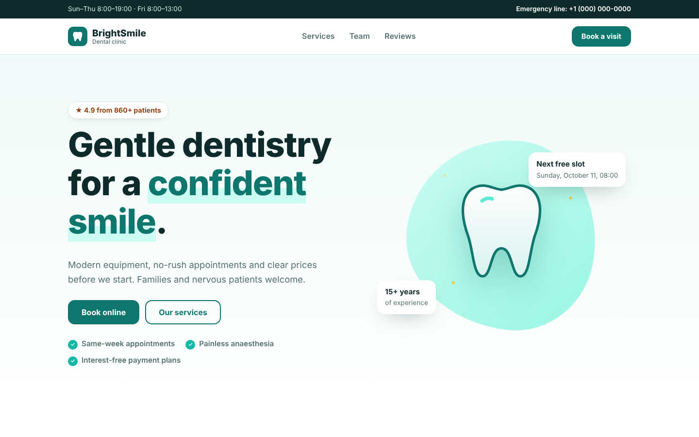
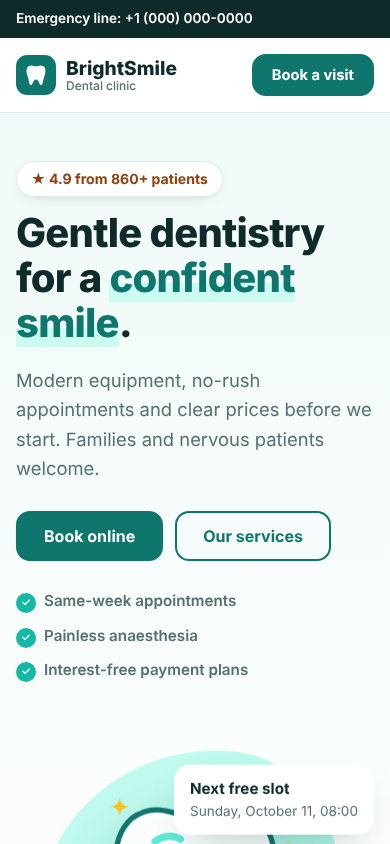

# BrightSmile Dental — Clinic Website with Online Booking

A clean, trustworthy website for a dental clinic with a 3-step online booking wizard, services with prices, team and reviews slider.

> Demo project by **[MoonWave](https://moonwave-studio.com)**. The business is fictional and the forms don't send anything.

**Live demo:** _coming soon_



<p align="center"></p>

## Features

- 3-step booking wizard: service → day & time → details, with progress indicator and validation
- Real calendar logic: working hours per weekday, past slots hidden, booked slots disabled
- "Next free slot" in the hero is calculated live
- Morphing blob and floating tooth animation (SVG + CSS)
- Auto-playing reviews slider with dots and arrow controls
- Fully responsive, keyboard accessible, respects prefers-reduced-motion
- SEO meta tags and Open Graph

## Tech stack

- Semantic HTML5
- Modern CSS (custom properties, grid, flexbox, `clamp()`, keyframe animations)
- Vanilla JavaScript (IntersectionObserver, no frameworks, no build step)
- Zero dependencies: loads fast and deploys anywhere

## Run locally

Open `index.html` in a browser, or serve the folder:

```bash
npx serve .
```

## Deploy

Static site: drag the folder into Netlify, or connect this repo with no build command and `.` as the publish directory.

## Want a site like this?

I build fast, animated websites for small businesses and startups.

- Studio: [moonwave-studio.com](https://moonwave-studio.com)
- Hire me on [Upwork](https://www.upwork.com/freelancers/~01f7f6a71cc800d79b)

---

© MoonWave. All rights reserved. See [LICENSE](LICENSE).
